# AI-Based International Air Traffic Analysis and Forecasting Using Machine Learning, AIS, and PSO

## Overview

The **AI-Based International Air Traffic Analysis and Forecasting** project is a machine learning application designed to analyze historical international air passenger and freight traffic, identify transportation trends, compare airline operators, and generate future traffic predictions.

The project uses various machine learning regression algorithms to understand historical aviation patterns and estimate future passenger and freight volumes.

To improve model performance, two nature-inspired optimization techniques are implemented:

- **Artificial Immune System (AIS)** using Clonal Selection Optimization
- **Particle Swarm Optimization (PSO)**

These optimization algorithms are used to tune Random Forest Regression hyperparameters and compare their performance with conventional machine learning models.

The project includes data preprocessing, exploratory data analysis, machine learning model training, optimization, evaluation, forecasting, and visualization.

---

## Project Objectives

The major objectives of this project are:

1. Analyze historical international air passenger traffic.
2. Examine international freight transportation trends.
3. Compare Indian and foreign airline operators.
4. Identify changes in passenger and freight traffic over time.
5. Develop machine learning models for traffic prediction.
6. Evaluate regression models using standard performance metrics.
7. Optimize Random Forest Regression using AIS.
8. Optimize Random Forest Regression using PSO.
9. Compare baseline, AIS, and PSO model performance.
10. Generate future passenger and freight traffic forecasts.
11. Visualize historical and predicted aviation trends.
12. Export trained models, evaluation results, and predictions.

---

## Dataset Description

**Dataset Name:** `IntlTrafficData.csv`

The dataset contains historical international air traffic information, including passenger movement and freight transportation for Indian and foreign airline operators.

### Dataset Features

| Column | Description |
|--------|-------------|
| YEAR | Financial year of the recorded traffic |
| OPERATOR | Airline operator category |
| PAX TO | Outbound international passenger traffic |
| PAX FROM | Inbound international passenger traffic |
| PAX TOTAL | Total international passenger traffic |
| FREIGHT TO | Outbound international freight traffic |
| FREIGHT FROM | Inbound international freight traffic |
| FREIGHT TOTAL | Total international freight traffic |

### Operator Categories

The dataset contains the following operator categories:

- **INDIAN:** Traffic handled by Indian operators.
- **FOREIGN:** Traffic handled by foreign operators.
- **TOTAL:** Aggregate international traffic.

The TOTAL category is an aggregate and should not be added again to Indian and foreign operator traffic.

### Input Features

The predictive models use:

- `YEAR_START`
- `OPERATOR`

### Target Variables

The project predicts:

- `PAX_TOTAL`
- `FREIGHT_TOTAL`

The prediction task is formulated as **multi-output regression**.

---

## Technologies Used

### Programming Language

- Python 3.10+

### Libraries

| Library | Purpose |
|---------|---------|
| NumPy | Numerical computations |
| Pandas | Dataset processing and analysis |
| Matplotlib | Data visualization |
| Seaborn | Statistical visualization |
| Scikit-learn | Machine learning algorithms |
| Joblib | Model serialization |
| Pickle | Python object serialization |
| H5py | HDF5 model artifact storage |
| PyYAML | YAML configuration export |
| JSON | Model metadata storage |

### Development Environments

- Jupyter Notebook
- Visual Studio Code
- Python IDE
- Google Colab (after updating dataset paths)

---

## Project Architecture

The overall project workflow is:

```text
International Air Traffic Dataset
                |
                v
        Data Collection
                |
                v
        Data Preprocessing
                |
                v
      Exploratory Data Analysis
                |
                v
        Feature Selection
                |
                v
    Chronological Train/Test Split
                |
                v
       Machine Learning Models
                |
       +--------+--------+
       |        |        |
       v        v        v
   Baseline    AIS      PSO
    Models  Optimization Optimization
       |        |        |
       v        v        v
   Regression Model Training
                |
                v
       Performance Evaluation
                |
                v
       Model Comparison
                |
                v
        Future Forecasting
                |
                v
       Results and Graphs
                |
                v
       Model Export and Storage
```

---

## Machine Learning Algorithms

The following algorithms are implemented.

### 1. Linear Regression

Linear Regression establishes a relationship between input features and continuous target variables.

It serves as a simple baseline for analyzing trends in international passenger and freight traffic.

### 2. Ridge Regression

Ridge Regression extends Linear Regression by introducing L2 regularization.

It helps control large model coefficients and can improve generalization.

### 3. Decision Tree Regressor

Decision Tree Regression divides the feature space into regions and predicts numerical values based on learned decision rules.

It can capture nonlinear relationships in historical traffic data.

### 4. Random Forest Regressor

Random Forest Regression combines predictions from multiple decision trees.

It reduces variance compared with individual decision trees and can capture nonlinear patterns.

### 5. Gradient Boosting Regressor

Gradient Boosting builds models sequentially, with each model attempting to reduce the errors of previous models.

The implementation supports passenger and freight prediction through multi-output regression.

### 6. AIS-Optimized Random Forest

Artificial Immune System optimization searches for suitable Random Forest hyperparameters using clonal selection and mutation.

### 7. PSO-Optimized Random Forest

Particle Swarm Optimization searches for Random Forest hyperparameters by updating candidate solutions based on personal and global best positions.

---

## Artificial Immune System (AIS)

### Introduction

Artificial Immune System is a nature-inspired optimization technique based on biological immune system behavior.

It simulates processes such as antibody generation, affinity evaluation, clonal selection, hypermutation, and replacement.

In this project, AIS is used to optimize Random Forest Regression hyperparameters.

### AIS Optimization Process

**Step 1: Population Initialization**

Generate an initial population of candidate solutions called antibodies.

Each antibody represents a combination of Random Forest hyperparameters.

**Step 2: Fitness Evaluation**

Train and validate the model using each antibody's hyperparameters.

Calculate the normalized validation Mean Absolute Error.

**Step 3: Antibody Selection**

Select the antibodies with the lowest validation errors.

**Step 4: Clonal Expansion**

Create multiple copies of high-quality antibodies.

**Step 5: Hypermutation**

Apply mutations to cloned antibodies to explore nearby hyperparameter combinations.

**Step 6: Population Replacement**

Retain promising solutions and introduce new antibodies to maintain diversity.

**Step 7: Final Model Training**

Use the best hyperparameters to train the AIS-optimized Random Forest model.

### AIS Hyperparameters

The implementation searches over:

| Hyperparameter | Search Range |
|----------------|--------------|
| n_estimators | 30–150 |
| max_depth | 2–8 |
| min_samples_split | 2–8 |
| min_samples_leaf | 1–4 |
| max_features | 0.4–1.0 |

### AIS Configuration

| Parameter | Value |
|-----------|-------|
| Population Size | 8 |
| Generations | 8 |
| Elite Antibodies | 3 |
| Clones per Elite | 3 |
| Random Replacements | 2 |

### AIS Outputs

- `ais_model.pkl`
- `ais_model.h5`
- `ais_model.yaml`
- `ais_model.json`
- `ais_accuracy_graph.png`
- `ais_heatmap.png`
- `ais_comparison_graph.png`
- `ais_optimization_graph.png`
- `ais_result.csv`
- `ais_result_graph.png`
- `ais_prediction.csv`
- `ais_prediction_graph.png`
- `ais_freight_prediction_graph.png`
- `ais_passenger_trend_graph.png`
- `ais_freight_trend_graph.png`
- `ais_model_comparison.csv`
- `ais_optimization_history.csv`
- `ais_model_summary.csv`
- `ais_processed_data.csv`

---

## Particle Swarm Optimization (PSO)

### Introduction

Particle Swarm Optimization is a population-based optimization technique inspired by the collective movement of birds and fish.

Each particle represents a possible solution within the hyperparameter search space.

Particles update their positions according to their own best-known solutions and the best solution discovered by the swarm.

### PSO Optimization Process

**Step 1: Particle Initialization**

Initialize particles with random positions and velocities.

**Step 2: Fitness Evaluation**

Evaluate each particle using normalized validation prediction error.

**Step 3: Personal Best Update**

Update each particle's best-known position.

**Step 4: Global Best Update**

Identify the best solution discovered by the entire swarm.

**Step 5: Velocity Update**

Update particle velocities using inertia, cognitive learning, and social learning.

**Step 6: Position Update**

Move particles through the search space while enforcing hyperparameter bounds.

**Step 7: Model Training**

Train Random Forest Regression using the optimized hyperparameters.

### PSO Mathematical Model

Particle velocity is updated using:

\[
v_i(t+1)=wv_i(t)+c_1r_1(p_i-x_i(t))+c_2r_2(g-x_i(t))
\]

Particle position is updated using:

\[
x_i(t+1)=x_i(t)+v_i(t+1)
\]

Where:

- \(v_i\): Particle velocity
- \(x_i\): Particle position
- \(w\): Inertia weight
- \(c_1\): Cognitive coefficient
- \(c_2\): Social coefficient
- \(r_1,r_2\): Random values between 0 and 1
- \(p_i\): Personal best position
- \(g\): Global best position

### PSO Configuration

| Parameter | Value |
|-----------|-------|
| Number of Particles | 10 |
| Number of Iterations | 12 |
| Inertia Weight | 0.7 |
| Cognitive Coefficient | 1.5 |
| Social Coefficient | 1.5 |

### PSO Outputs

- `pso_model.pkl`
- `pso_model.h5`
- `pso_model.yaml`
- `pso_model.json`
- `pso_accuracy_graph.png`
- `pso_heatmap.png`
- `pso_comparison_graph.png`
- `pso_optimization_graph.png`
- `pso_result.csv`
- `pso_result_graph.png`
- `pso_prediction.csv`
- `pso_prediction_graph.png`
- `pso_freight_prediction_graph.png`
- `pso_passenger_trend_graph.png`
- `pso_freight_trend_graph.png`
- `pso_model_comparison.csv`
- `pso_optimization_history.csv`
- `pso_model_summary.csv`
- `pso_processed_data.csv`

---

## Data Preprocessing

The preprocessing stage prepares the dataset for machine learning.

### 1. Column Name Standardization

Column names are converted into uppercase and spaces are replaced with underscores.

Example:

```python
df.columns = (
    df.columns
    .str.strip()
    .str.upper()
    .str.replace(r"\s+", "_", regex=True)
)
```

### 2. Financial Year Conversion

The financial year is converted into a numerical starting year.

Example:

```text
2010-11 -> 2010
2011-12 -> 2011
2012-13 -> 2012
```

### 3. Missing Value Handling

Records missing required target values or essential identifiers are removed.

Feature preprocessing uses appropriate imputation methods.

### 4. Categorical Encoding

The `OPERATOR` feature is transformed using One-Hot Encoding.

### 5. Feature Selection

The models use financial year and operator category as predictors.

Passenger and freight totals are used as prediction targets.

### 6. Chronological Data Splitting

The dataset is divided into training and testing sets according to financial year.

Earlier years are used for training and later years for testing.

This reduces the risk of future information leaking into model training.

### 7. Optimization Validation

AIS and PSO use expanding-window validation within the training years.

The final testing years are not used to select optimized hyperparameters.

---

## Model Evaluation Metrics

The project uses regression metrics because passenger and freight traffic are continuous numerical variables.

### Mean Absolute Error (MAE)

\[
MAE=\frac{1}{n}\sum_{i=1}^{n}|y_i-\hat{y}_i|
\]

MAE measures the average absolute difference between actual and predicted values.

Lower MAE indicates better predictive performance.

### Root Mean Squared Error (RMSE)

\[
RMSE=\sqrt{\frac{1}{n}\sum_{i=1}^{n}(y_i-\hat{y}_i)^2}
\]

RMSE gives greater weight to large prediction errors.

Lower RMSE is preferred.

### R-Squared Score (R²)

\[
R^2=1-\frac{\sum(y_i-\hat{y}_i)^2}
{\sum(y_i-\bar{y})^2}
\]

R² measures model performance relative to predicting the mean target value.

- R² = 1 indicates perfect predictions.
- R² = 0 indicates performance equivalent to predicting the test-set mean.
- R² < 0 indicates worse performance than that baseline.

R² is not a classification accuracy percentage.

### Normalized Mean Absolute Error

Passenger and freight volumes have different numerical scales.

Normalized MAE is used to compare performance across both prediction targets.

The optimization objective is to minimize the average normalized prediction error.

---

## Results and Visualization

The project automatically generates visualizations for model evaluation, traffic analysis, and forecasting.

### 1. Model Accuracy Graph

The following graph compares the R² scores of different machine learning regression models.

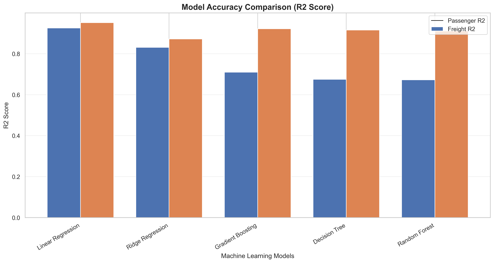

**Figure 1: Machine Learning Model Accuracy Comparison**

The graph displays passenger and freight R² scores for the baseline regression models.

Higher R² scores generally indicate better predictive performance.

Negative R² values are possible and indicate poor performance relative to a mean-value baseline.

### 2. Correlation Heatmap

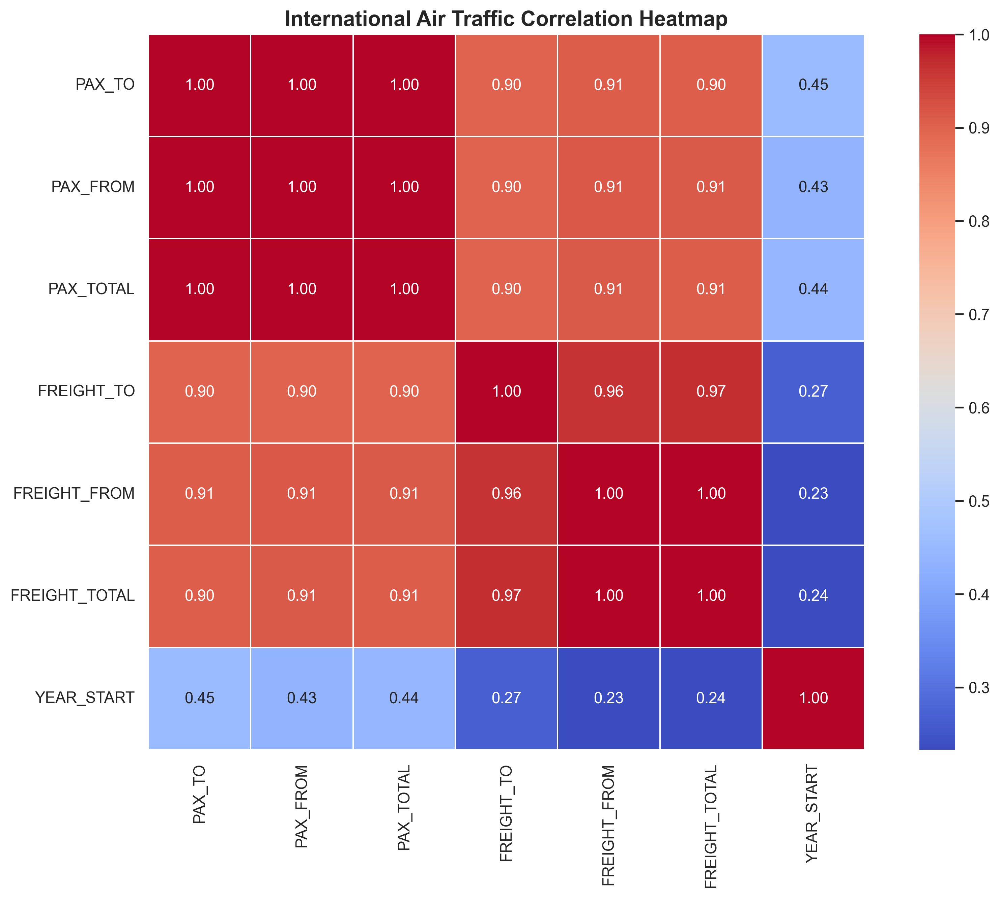

**Figure 2: Correlation Analysis**

The heatmap illustrates statistical relationships among passenger traffic, freight traffic, and financial year.

It helps identify variables that tend to increase or decrease together.

Correlation does not establish causation.

### 3. Model Comparison Graph

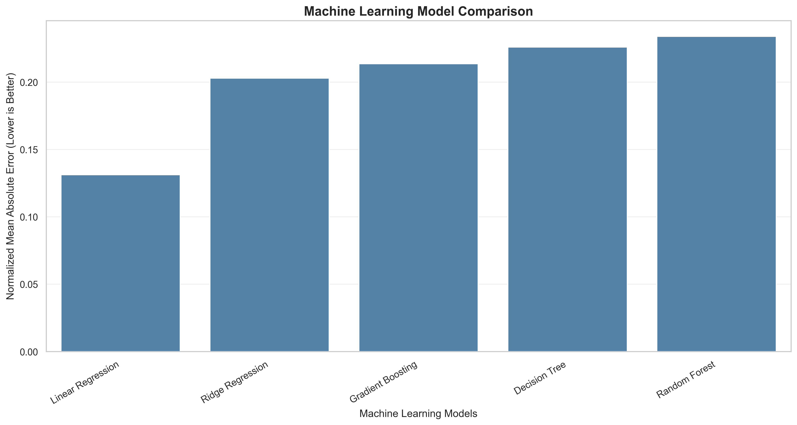

**Figure 3: Model Performance Comparison**

This graph compares normalized prediction errors across the machine learning models.

Lower normalized error indicates better performance on the held-out test data.

### 4. Actual vs Predicted Results

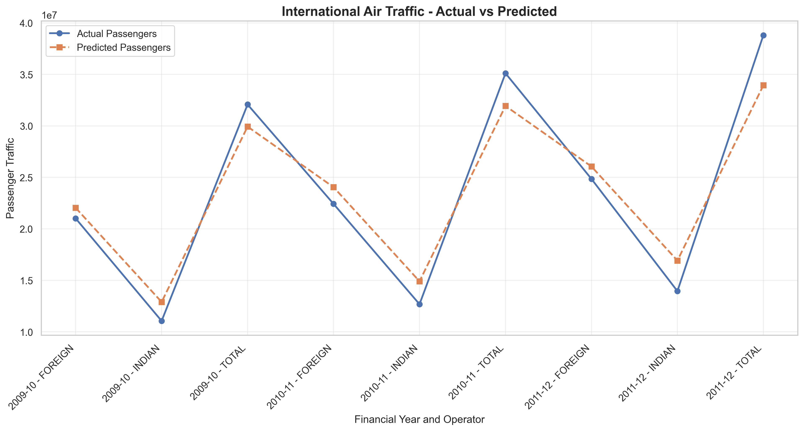

**Figure 4: Actual and Predicted Passenger Traffic**

This graph compares actual passenger traffic with model predictions for historical test records.

It provides a visual indication of prediction errors.

### 5. Future Passenger Traffic Prediction

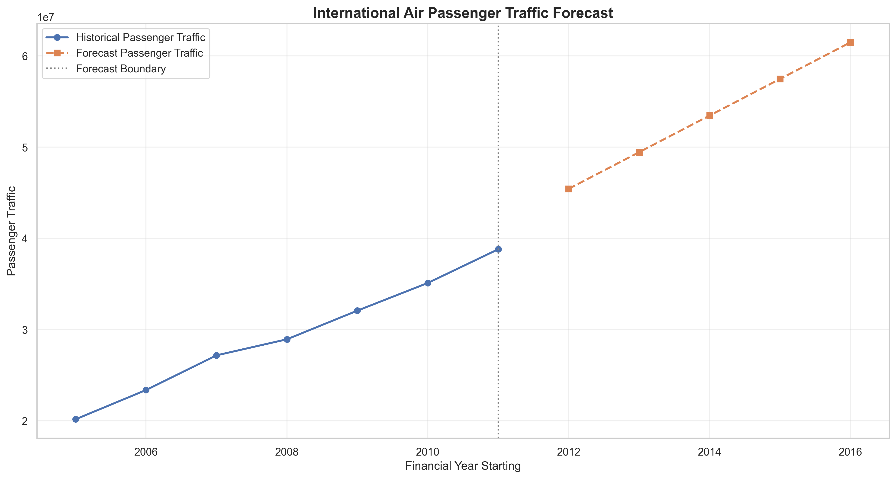

**Figure 5: International Passenger Traffic Forecast**

The graph shows historical passenger traffic alongside exploratory future forecasts.

The forecasts are generated using a model trained on the available historical dataset.

### 6. AIS Model Comparison

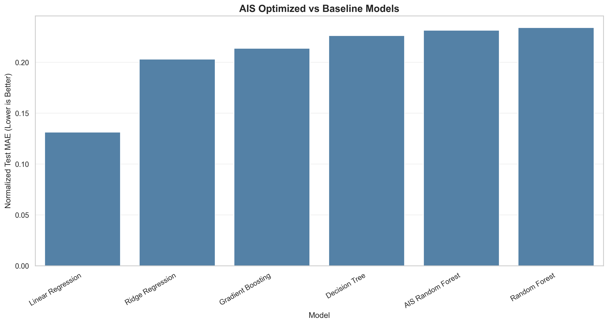

**Figure 6: AIS Optimization Performance**

The graph compares the AIS-optimized Random Forest with baseline machine learning models.

It helps determine whether AIS hyperparameter optimization improves predictive performance.

### 7. PSO Model Comparison

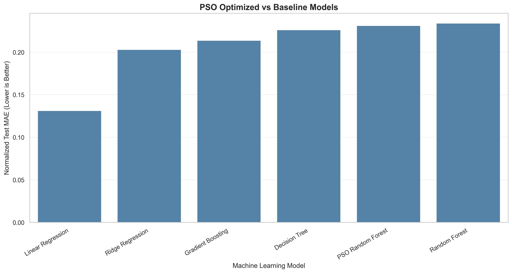

**Figure 7: PSO Optimization Performance**

The graph compares PSO-optimized Random Forest Regression against conventional machine learning models.

It illustrates the effect of PSO hyperparameter optimization.

### 8. AIS Optimization Convergence

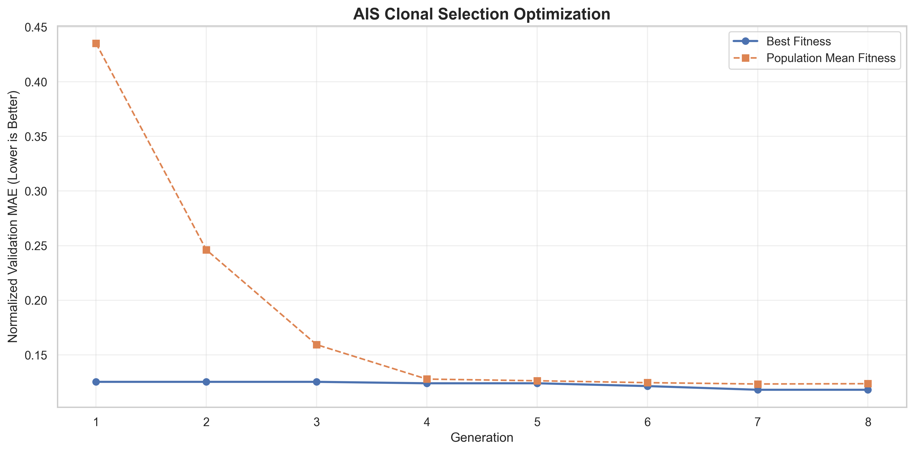

**Figure 8: AIS Fitness Convergence**

The graph displays the best validation fitness and average population fitness across AIS generations.

### 9. PSO Optimization Convergence

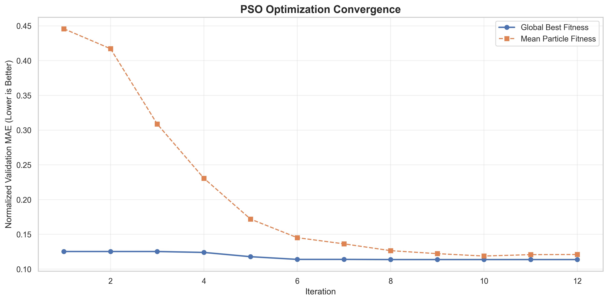

**Figure 9: PSO Fitness Convergence**

The graph displays the global best fitness and average particle fitness across PSO iterations.

### 10. AIS Passenger Forecast

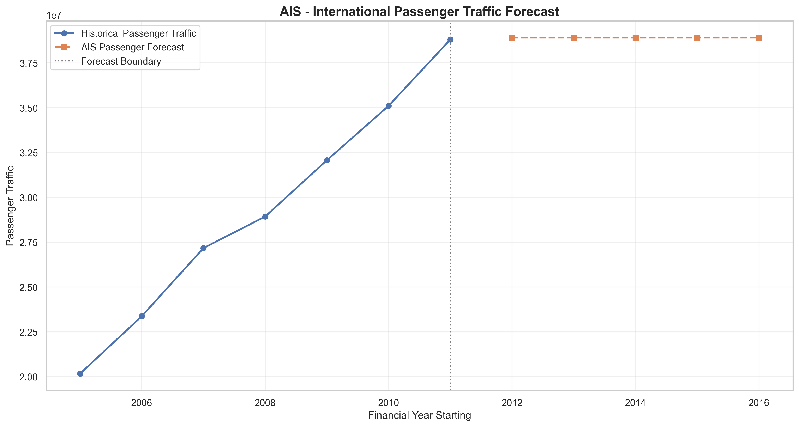

**Figure 10: AIS-Based Passenger Traffic Forecast**

The graph visualizes historical passenger traffic and exploratory forecasts produced using the AIS-optimized model.

### 11. PSO Passenger Forecast

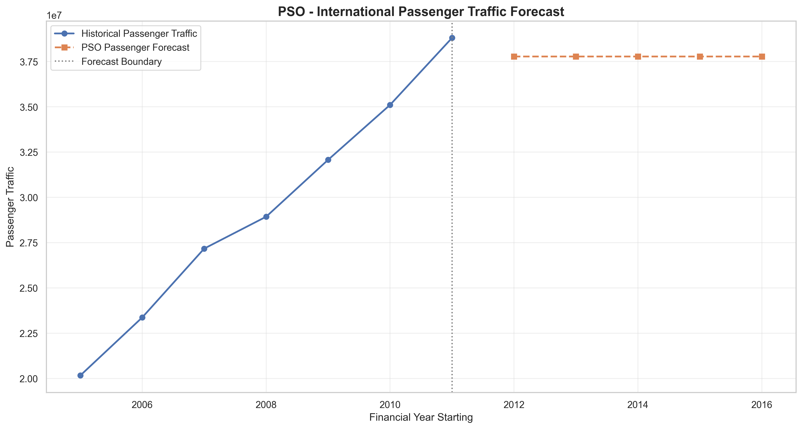

**Figure 11: PSO-Based Passenger Traffic Forecast**

The graph visualizes historical passenger traffic and exploratory forecasts produced using the PSO-optimized model.

---

## Project Folder Structure

```text
AI-Based International Air Traffic Analysis/
│
├── IntlTrafficData.csv
│
├── README.md
│
├── air_traffic_model.pkl
├── air_traffic_model.h5
├── air_traffic_model.yaml
├── air_traffic_model.json
│
├── accuracy_graph.png
├── heatmap.png
├── comparison_graph.png
├── result.csv
├── result_graph.png
├── prediction.csv
├── prediction_graph.png
├── model_comparison.csv
├── model_summary.csv
│
├── freight_prediction_graph.png
├── passenger_trend_graph.png
├── freight_trend_graph.png
│
├── ais_model.pkl
├── ais_model.h5
├── ais_model.yaml
├── ais_model.json
│
├── ais_accuracy_graph.png
├── ais_heatmap.png
├── ais_comparison_graph.png
├── ais_optimization_graph.png
│
├── ais_result.csv
├── ais_result_graph.png
├── ais_prediction.csv
├── ais_prediction_graph.png
├── ais_freight_prediction_graph.png
│
├── ais_passenger_trend_graph.png
├── ais_freight_trend_graph.png
├── ais_model_comparison.csv
├── ais_optimization_history.csv
├── ais_model_summary.csv
├── ais_processed_data.csv
│
├── pso_model.pkl
├── pso_model.h5
├── pso_model.yaml
├── pso_model.json
│
├── pso_accuracy_graph.png
├── pso_heatmap.png
├── pso_comparison_graph.png
├── pso_optimization_graph.png
│
├── pso_result.csv
├── pso_result_graph.png
├── pso_prediction.csv
├── pso_prediction_graph.png
├── pso_freight_prediction_graph.png
│
├── pso_passenger_trend_graph.png
├── pso_freight_trend_graph.png
├── pso_model_comparison.csv
├── pso_optimization_history.csv
├── pso_model_summary.csv
└── pso_processed_data.csv
```

The folder structure represents the expected outputs after successfully executing the relevant project scripts.

---

## Installation

### Step 1: Install Python

Install Python 3.10 or later.

Check the Python version:

```bash
python --version
```

### Step 2: Create a Virtual Environment

```bash
python -m venv venv
```

Activate the environment on Windows:

```bash
venv\Scripts\activate
```

### Step 3: Install Required Libraries

```bash
pip install numpy pandas matplotlib seaborn scikit-learn joblib h5py pyyaml
```

Alternatively, create a `requirements.txt` file containing:

```text
numpy
pandas
matplotlib
seaborn
scikit-learn
joblib
h5py
PyYAML
```

Install dependencies:

```bash
pip install -r requirements.txt
```

---

## How to Run the Project

### Step 1: Download the Dataset

Place `IntlTrafficData.csv` in the project directory.

### Step 2: Configure the Dataset Path

```python
from pathlib import Path

PROJECT_DIR = Path(
    r"C:\Users\sagni\Downloads"
    r"\AI-Based International Air Traffic Analysis"
)

DATASET_PATH = PROJECT_DIR / "IntlTrafficData.csv"
```

### Step 3: Execute the Baseline Machine Learning Code

Run the baseline machine learning and visualization implementation.

This generates the standard model comparison, results, predictions, and graphs.

### Step 4: Execute the AIS Implementation

Run the AIS optimization code.

This generates the optimized Random Forest model and associated outputs using the `ais_` prefix.

### Step 5: Execute the PSO Implementation

Run the PSO optimization code.

This generates the optimized Random Forest model and associated outputs using the `pso_` prefix.

### Step 6: Review the Results

Open the generated CSV files and PNG graphs to examine model performance and forecasts.

---

## Loading the Trained Models

The trained scikit-learn models are stored in PKL format.

### Load Baseline Model

```python
import joblib

model = joblib.load("air_traffic_model.pkl")
```

### Load AIS Model

```python
import joblib

ais_model = joblib.load("ais_model.pkl")
```

### Load PSO Model

```python
import joblib

pso_model = joblib.load("pso_model.pkl")
```

Only load model files from trusted sources because Python model serialization can execute code during deserialization.

### Example Prediction

```python
import pandas as pd
import joblib

model = joblib.load("pso_model.pkl")

sample = pd.DataFrame({
    "YEAR_START": [2027],
    "OPERATOR": ["INDIAN"]
})

prediction = model.predict(sample)

print("Predicted Passenger Traffic:", prediction[0][0])
print("Predicted Freight Traffic:", prediction[0][1])
```

The example illustrates the prediction interface. Its output depends on the trained model and historical dataset.

### Model File Formats

| Format | Description |
|--------|-------------|
| PKL | Serialized scikit-learn prediction pipeline |
| H5 | HDF5 container holding serialized model data |
| YAML | Model configuration and evaluation metadata |
| JSON | Model metadata and evaluation results |

**Note:** The H5 files generated by this project are not native Keras models. They contain serialized scikit-learn pipelines stored inside HDF5 containers.

---

## Comparative Analysis: Baseline vs AIS vs PSO

The project evaluates three modeling approaches.

| Approach | Description | Optimization |
|----------|-------------|--------------|
| Baseline ML | Conventional regression models | Fixed hyperparameters |
| AIS | Random Forest optimized using Clonal Selection | Artificial Immune System |
| PSO | Random Forest optimized using particle movement | Particle Swarm Optimization |

### Comparison Criteria

The approaches can be compared using:

- Passenger MAE
- Freight MAE
- Passenger RMSE
- Freight RMSE
- Passenger R²
- Freight R²
- Normalized MAE
- Optimization convergence

### Expected Analysis

The comparison should identify:

1. Which model achieves the lowest prediction error.
2. Whether AIS improves Random Forest performance.
3. Whether PSO improves Random Forest performance.
4. Which optimization method converges more effectively.
5. Whether optimized models outperform conventional baselines.

AIS and PSO do not guarantee better performance. Their effectiveness must be determined from the generated evaluation results.

---

## Applications

### 1. Aviation Traffic Analysis

Analyze international passenger and freight movement patterns over time.

### 2. Airline Operator Comparison

Compare historical traffic handled by Indian and foreign operators.

### 3. Airport Capacity Planning

Provide exploratory traffic indicators that may support preliminary capacity planning research.

### 4. Freight Transportation Analysis

Study historical freight traffic patterns and changes.

### 5. Aviation Research

Support academic research involving regression, optimization, and transportation analytics.

### 6. Machine Learning Benchmarking

Compare conventional regression algorithms with nature-inspired optimization methods.

---

## Advantages

- Supports passenger and freight traffic analysis.
- Implements multiple regression algorithms.
- Uses chronological train/test splitting.
- Includes AIS and PSO hyperparameter optimization.
- Provides graphical performance comparisons.
- Generates CSV reports automatically.
- Saves trained machine learning models.
- Supports reproducible experiments using fixed random seeds.
- Produces exploratory future forecasts.
- Organizes optimization results with separate prefixes.

---

## Limitations

### 1. Small Dataset

The available dataset contains relatively few financial years.

This limits the amount of information available for model training and evaluation.

### 2. Forecasting Uncertainty

Long-term predictions may be unreliable because the models have limited historical observations.

### 3. Limited Predictive Features

The current models use financial year and operator category.

External factors such as fuel prices, economic conditions, tourism, airline capacity, and government policies are not included.

### 4. Tree-Based Extrapolation

Random Forest models generally do not extrapolate trends beyond the historical range in the same way as explicit time-trend models.

Future forecasts may therefore remain nearly constant.

### 5. Optimization Limitations

AIS and PSO can improve hyperparameter selection but cannot compensate for missing predictive information.

### 6. Limited Statistical Confidence

Results based on a small test period may vary considerably when the evaluation period changes.

---

## Future Enhancements

The project can be extended through the following improvements:

1. Collect additional years of international air traffic data.
2. Incorporate monthly or quarterly aviation statistics.
3. Include airport-level passenger and freight information.
4. Integrate tourism and economic indicators.
5. Incorporate airline capacity and route information.
6. Evaluate additional time-series forecasting models.
7. Implement ARIMA and SARIMA forecasting.
8. Explore LSTM and GRU models when sufficient data becomes available.
9. Compare AIS and PSO using repeated experiments.
10. Implement nested time-series cross-validation.
11. Develop an interactive Streamlit dashboard.
12. Deploy the prediction model through a web application.
13. Add forecast uncertainty intervals.
14. Implement automated reporting and visualization.
15. Integrate updated aviation datasets through APIs.

---

## Conclusion

The **AI-Based International Air Traffic Analysis and Forecasting Using Machine Learning, AIS, and PSO** project demonstrates how machine learning can be applied to historical aviation data to analyze passenger and freight transportation patterns.

The implementation combines conventional regression algorithms with Artificial Immune System and Particle Swarm Optimization techniques.

AIS uses clonal selection and mutation to explore Random Forest hyperparameter combinations, while PSO uses collective particle movement to search for promising configurations.

The project evaluates model performance using MAE, RMSE, R², and normalized prediction error.

It also produces model comparison graphs, correlation heatmaps, historical result comparisons, future traffic predictions, and optimization convergence visualizations.

The generated outputs provide a foundation for understanding machine learning regression and nature-inspired optimization in aviation analytics.

Because the dataset is small, the forecasts should be considered exploratory rather than operational predictions.

Overall, the project serves as an academic demonstration of data preprocessing, regression modeling, hyperparameter optimization, performance evaluation, visualization, and model serialization.

---

## Project Information

**Project Title:** AI-Based International Air Traffic Analysis and Forecasting Using Machine Learning, AIS, and PSO

**Domain:** Artificial Intelligence and Machine Learning

**Application Area:** Aviation Analytics and Traffic Forecasting

**Programming Language:** Python

**Machine Learning Type:** Multi-Output Regression

**Optimization Algorithms:**
- Artificial Immune System (AIS)
- Particle Swarm Optimization (PSO)

**Dataset:** IntlTrafficData.csv

**Primary Visualization:** accuracy_graph.png

**Model Storage Formats:** PKL, H5, YAML, JSON

---

## License

This project is intended for educational, academic research, and machine learning experimentation.

Dataset usage remains subject to the original data provider's terms and licensing requirements.
